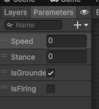
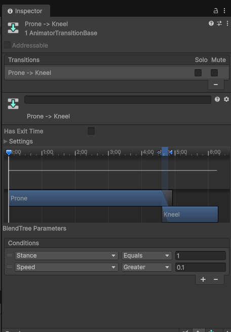
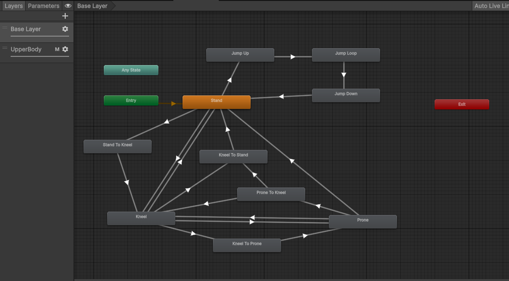
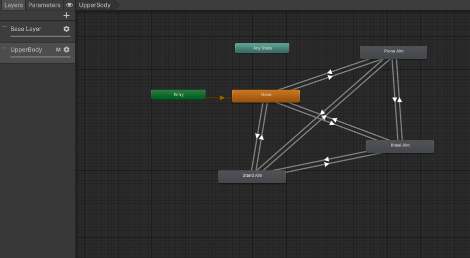

---
{
  "title": "유니티 애니메이터 공부",
  "date": "2026-11-14",
  "category": "Unity",
  "tags": [
    "기능공부",
    "Dino Cleaner"
  ],
  "summary": "",
  "cover": "",
  "draft": false
}
---
# 1. 블랜드 트리
하나의 노드에 여러 상태가 따로 존재할 때 특정 변수 값에 따라 애니메이션을 부드럽게 섞어줌

서기-서서 걷기 / 앉기-앉아서 걷기 / 엎드리기-기어가기 를 묶음으로 묶어서 처리했음. 

- `Speed = 0` : 대기 (Idle)
- `Speed = 1.0` : 걷기 (Walk)

스크립트에서 플레이어의 이동속도를 계산해 애니메이터의 `speed`값으로 넘겨주면 이제 사이 값 따라 + 블랜드 트리 가중치 따라 캐릭터의 애니메이션이 결정됨.

# 2. Transition & Parameter
### Parameter

애니메이터 좌측에 생성할 수 있음. 트랜지션, 블랜드 트리 등에 필요함

### Transition

말 그대로 노드 간 엣지 역할. 근데 엣지에도 뭔가 조건들이 많았음.
- `Has Exit Time`: 체크 박스로 존재. True일 경우 진행중인 애니메이션이 끝나고 나서 다음 상태로 넘어감. 체크 해제 시 즉시 넘어감
- `Conditions` 앞서 설정한 Parameter에 조건을 걸어서 조건을 만족하면 넘어가게 함.

### 내가 게임에서 처리한 부분 - 자세 전환
#### 가만히 서서 자세 전환
자세 전환 키를 눌러서 자세를 전환할 때 (ex. stand -> kneel) 노드는 stand idle(loop), stand to kneel(전환 애니메이션), kneel idle(loop)가 있었다. stand idle -> stand to kneel 같은 경우 `Has Exit Time`을 체크 해제하고 즉시 엎드리기로 전환하게 했고, `Coinditions`에는 stance가 '앉기'일 때 and speed가 0일 때(정확히는 0.1보다 작을 때)를 기준으로 가만히 서서 자세를 전환할 때는 모션이 제대로 재생되게 했다. 그리고 자세 전환 애니메이션 (stand to kneel)이 끝나면 자동으로 kneel idle 상태가 되게 하기 위해 해당 트랜지션에 `Has Exit Time`을 True로(재생이 끝나고 넘어가도록), `Conditions`에는 아무 것도 없도록 했다.

#### 서서 자세 전환
그렇다면 걸으면서 전환할 때는 어떻게 해야할까? 그냥 stand -> kneel의 직접 연결 Transition을 만들고 고정된 전환 시간을 줬다.

# 3. Avatar Mask
캐릭터가 걸어다니면서 총을 쏠 때는 어떻게 해야할까? ~~사실 우리게임이 총쏘는 게임은 아니다~~
아~ 상체는 총쏘고 하체는 걷기 하고싶다~ -> 됨

### 아바타 마스크 사용법
Project 창에서 `Avatar Mask`를 생성하고, 원하는 부위들만 선택을 한다. 그러고나서 다시 애니메이터 창으로 돌아와서 Layer를 추가하고 새로 추가한다.
나같은 경우 전신 (Base Layer)와 상체 (UpperBody Layer)로 나눠서 상체만 조준 할 수 있도록 했다.
말로 백번 설명하는 것 보다 한 번 해보는게 좋을 것 같다.

### 트러블 슈팅
그렇다면 서서 총을 쏘다가 앉기로 전환하면 어떻게 해야할까? (Upperbody Layer가 Idle이 아닌 상태에서 Base Layer가 Transition이 발생할 때)
UpperBody Layer에 stand aim <-> kneel aim 트랜지션을 만들어줬더니 해결됐다.