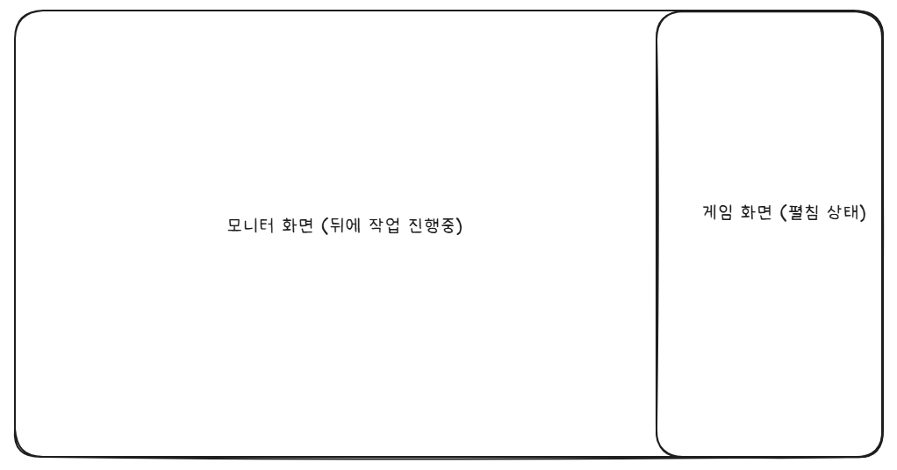
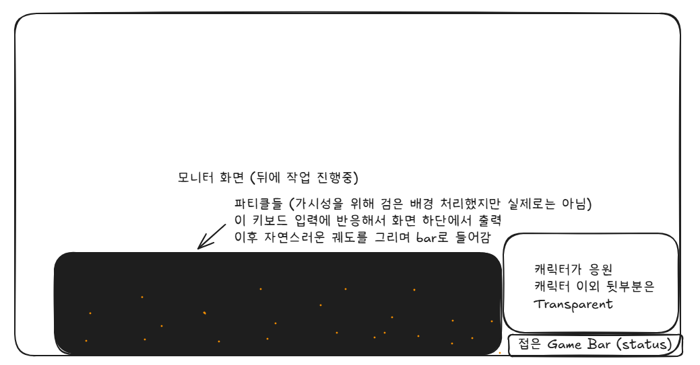

---
{
  "title": "11/28 개발일지",
  "date": "2026-11-28",
  "category": "DevLog",
  "tags": [
    "기획",
    "검증"
  ],
  "summary": "",
  "cover": "",
  "draft": false
}
---
# 방치형 게임 만들기 그 위대한 시작

기존 캡스톤 디자인에서 만든 Drill Idle ([github](https://github.com/koseongboy/Drill_Game))에서 "게임 바깥의 입력이 공장의 동력이 된다 -> 생산성 도구로써의 역할도 가능하다" 의 기획 구조를 버리는 것은 아쉽다고 생각하게 됨.

## 출시를 해보자!

1인 개발을 목표로 출시를 해보는 것이 최종적인 목표

## 프로젝트 계획 수립

우선 이번 프로젝트는 투 트랙으로 진행할 예정

1. 게임 출시
2. 윈도우 키보드 마우스 입력 후킹 패키지 출시 (오픈소스 기여)

### 왜 이렇게 했느냐

솔직히 말하면 그냥 게임만 만들어도 되긴 하는데, cpp 포트폴리오가 아예 없는 건 너무한 것 같아서 오픈소스 기여를 통해 cpp 공부 해보려 함.

고로 절대로 ai가 코드를 직접 짜게 만들지 않고, 내가 코드를 손 수 써보는 것이 목표. (cpp 한정)

# 정한 기획 / 기능

### 1. 바꿀 공장의 기본적 동작

```Mermaid
flowchart LR
    IN["키보드 · 마우스 입력"] --> PW["동력"]
    PW --> M["채굴기"]
    M --> R["원자재"]
    R --> P["가공 시설"]
    P --> I["중간 재료"]
    I --> A["합성 시설"]
    A --> C["부품"]
    C --> F["최종 장치 조립"]
```
기본적인 틀은 새티스팩토리에서 가져옴. 아직 완전히 기본적인 틀이기 때문에 추후 세세한 기획을 해야할 듯.

### 2. 프로젝트 구조
ASEMDEF를 적용해 참조 방향을 컴파일 타임에서 정의. 게다가 컴파일 타임까지 감소.
```Mermaid
graph TD
  UI[Indiman.UI] --> Power[Indiman.Power]
  UI --> Production[Indiman.Production]
  UI --> Core[Indiman.Core]
  Power --> Core
  Production --> Core
  Core --> Data[Indiman.Data]
  UI --> Data
  Power --> Data
  Production --> Data
  TestsE[Indiman.Tests.EditMode] -.-> Production
  TestsE -.-> Power
  TestsE -.-> Core
  TestsE -.-> Data
  TestsP[Indiman.Tests.PlayMode] -.-> Production
  TestsP -.-> Power
  TestsP -.-> Core
  TestsP -.-> Data
```
위는 클로드가 짜준 참조 형태인데, 기능 구현하면서 수정하게 될 듯.

### 3. 생산성 도구로써의 역할
기본적인 게임 형태는 화면 우측에 플로팅 된 공장의 형태 (n*n 그리드, 탑뷰)


화면을 접을 수 있고 그렇게 된다면 하단에 게임 상태를 보여주는 Bar 형태 위에 캐릭터가 주기적으로 응원? 을 해주는 판떼기같은게 있음

추가로 키보드 마우스 입력 후킹이 감지될 때 마다 (혹은 몇 묶음이 감지될 떄 마다) 화면 하단에서 입자들이 뾰로롱~ 올라와서 하단 Bar로 흘러들어가는 형태를 보여주고 싶음.


물론 캐릭터 / 파티클은 설정으로 끌 수 있음.

### 후킹의 성능과 보안성 검증
#### 1. 저수준 훅 vs Raw Input
저수준 훅의 경우 동기 방식이기 때문에 입력 -> 집계 -> 넘김 순서로 작동한다. 사실 집계 자체는 큰 오버헤드가 없을 수 있으나 유니티가 돌아가면서 훅을 잡는 스레드가 막히게 될 경우가 있다. (씬 로딩, 프레임 드랍 등의 무거운 상황일 때) 이때 오버헤드가 발생한다.
따라서 cpp로 구현한 dll 안에 전용 스레드를 두고, 해당 스레드가 훅을 잡고, 유니티는 이를 읽어가도록 해야 한다.

Raw Input의 경우 비동기적으로 입력의 사본을 생성해 넘겨주기 때문에 입력 지연이 생기지 않는다. 이렇게 생각하면 무조건 raw input이 좋은거 아닌가? 싶겠지만 치명적인 문제가 있다. 바로 Unity Input System이 이미 Raw Input을 받고 있다는 점. Raw Input은 한 프로세스당 한  번만 등록 가능하고, 다시 등록하면 이를 덮어쓴다. Unity가 Raw Input을 등록하고 있기 때문에 키 입력을 못 받는 경우가 생길 수도, 혹은 키 입력을 받느라 게임 단축키를 이용 못 할 수도 있다.

#### 2. 다른 저수준 훅 프로그램과의 충돌
이전 [Drill Idle](https://github.com/koseongboy/Drill_Game)개발 시 빌드한 게임과 디스코드(단축키 설정 ON)를 같이 켜놨을 때, 외부 키 입력을 받지 못했던 버그가 있었다.

문제를 클로드와 상담했는데, 클로드에게 내 프로젝트 코드를 분석해달라고 했다. 그랬더니 예상되는 문제 상황을 두 가지 받았다. 근데 만족스럽진 않아서 구현해보고 테스트 해봐야할 것 같다.

#### 3. AI 토큰 사용량을 입력으로?
요즘 ai 에이전트를 이용해 작업을 하는 사람이 많다. 이때 AFK 상태가 되는 경우들이 있는데 일을 한 게 아니지 않는가. (엄)
그래서 일단은 AI 작업량 -> 토큰 사용량으로 가정하고 여러 시나리오를 구상해봤다.
1. **로컬 로그 읽기**: 클로드의 경우 `~/.claude/projects/<프로젝트>/<세션>.jsonl`폴더에 응답마다 토큰 사용량 등을 남기는 걸 검증했다. 그러나 로그 형식이 AI 모델마다 전부 다르고, 당장에라도 로그 형식이 바뀌면 유지보수가 매우 불편해진다. 또한 사용자(게이머)가 직접 폴더 연동을 해 주어야 하는 불편함이 있다.
2. **OTLP 연동**: 기업에서 토큰 사용량 등을 추적하기 위해 ai가 자기가 토큰을 사용하면 특정 서버에 push해 밀어넣는 OpenTelemetry라는 기술이 있다고 한다. 그러나 회사 pc 등에서 텔레메트리 설정 변경이 정책 위반일 수도 있고, 우리 프로그램이 사용하는 포트를 이미 회사에서 사용중일 수도 있다. 

줴라이.. 그럼 토큰 말고 다른 건 있을까? 이번엔 제미나이를 갈궈봤다.

- **작업 폴더 파일 변경 횟수:** AI가 한 게 아니라 그냥 파일이 변동되더라도 전부 반영해버려서 기각 
- **클립보드 변경 횟수:** 진심?
- **AI 도구 실행 · 포커스 시간:** ai 도구가 세상에 몇 개나 있는 줄 알고 모든 창 이름을 기억해서 포커스 시간을 측정함?
- **Git 통계:** 아직 인간이 ai를 이길 수 있구나

이러한 이유들로 인해 ai 사용량은 배제하기로 했다. 프롬프트 입력하면서 생긴 키보드 입력이 들어갈 테니깐..

#### 4. 접힌 화면에 대한 검증
게임 창의 영역은 화면 전체이지만, 테두리가 없고 나머지가 투명한 형식으로 진행할 예정. -> 투명한 부분에 대한 클릭이 통과되어 뒤 창으로 갈 수 있을까?
유니티 상에서 게임 오브젝트라면 클릭을 받고, 아니면 윈도우 api를 통해 뒤로 흘려보내게 하면 가능

애초에 투명하게 하는게 가능할까? -> UniWindowController라는 친구가 이미 깃헙에 오픈소스로 공개되어있음. 확인해보면 될 듯

#### 5. 가장 중요한 아트
대 황족 아트 님님님들께서 과연 내 프로젝트에 몸담아 주실까?
모르겠다. 일단 동작하는 프로토타입을 만들고, 테마를 적용할 수 있도록 구현한 뒤 여러 테마를 받아보도록 하자.

아트를 못 구했을 때 로컬 ai를 통해 이미지를 뽑아보는걸 목표로 해보자

